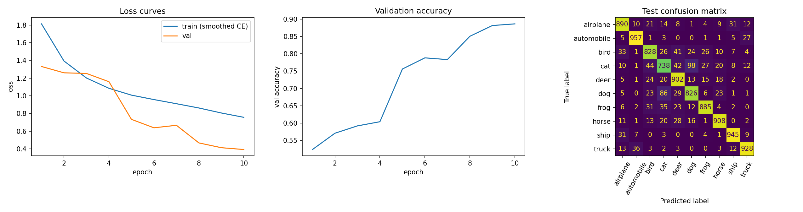
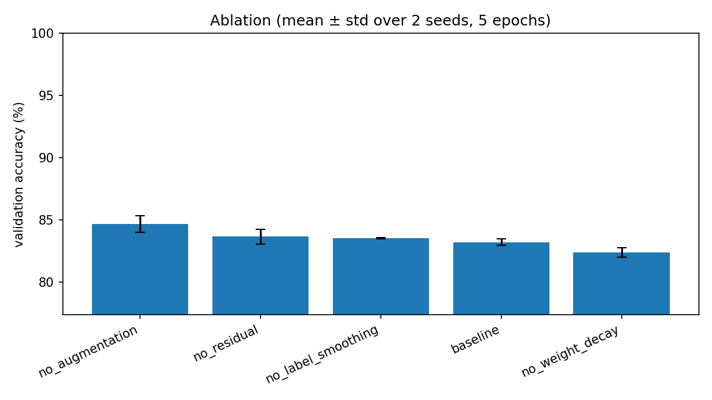
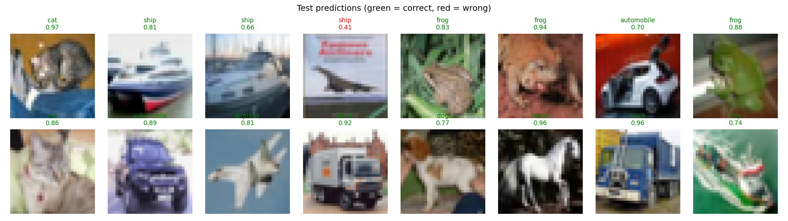

# CIFAR-10 Image Classification with a ResNet Built From Scratch: A Leak-Free Ablation Study

[](https://colab.research.google.com/github/kathokepiyush1011-cell/cifar10-resnet-ablation/blob/main/cifar10_resnet_ablation.ipynb)

## Overview
This project trains a small residual network (ResNet, ~0.7M parameters) from scratch in PyTorch to classify 32×32 color images into 10 classes. Beyond the final accuracy, the goal is to run the experiment correctly: a leak-free validation protocol, fixed seeds, and an ablation study that measures what each training ingredient actually contributes.

## Problem and Motivation
Image classification is a standard benchmark for studying how architecture and training choices affect generalization. Many projects report a single accuracy number with no evidence for *why* the model works. Here, each component (data augmentation, skip connections, label smoothing, weight decay) is removed one at a time and the change in accuracy is measured across multiple seeds.

## Dataset
- **CIFAR-10** (Krizhevsky, 2009): 60,000 color images of size 32×32 in 10 classes (airplane, automobile, bird, cat, deer, dog, frog, horse, ship, truck).
- Official split: 50,000 train / 10,000 test.
- **Split used here:** the 50,000 training images are divided into 45,000 train and 5,000 validation (stratified by class, fixed seed). The 10,000 test images are used **once per run**, only after selecting the best checkpoint on validation.
- Preprocessing: per-channel mean/std normalization. Augmentation (train only): random crop with 4-pixel padding and random horizontal flip. Validation and test images are never augmented.

## Method

### Model architecture
```
Input 3×32×32
  → Stem: Conv3×3 + BatchNorm + ReLU            → 32×32×32
  → Stage 1: 2 residual blocks (32 channels)    → 32×32×32
  → Stage 2: 2 residual blocks (64 channels)    → 64×16×16  (stride-2 downsample)
  → Stage 3: 2 residual blocks (128 channels)   → 128×8×8   (stride-2 downsample)
  → Global average pooling                      → 128
  → Linear                                      → 10 logits
```
Each residual block computes `y = ReLU(F(x) + x)`, where `F` is Conv-BN-ReLU-Conv-BN. The identity term gives gradients a direct path through the network, since ∂y/∂x = ∂F/∂x + I. A 1×1 convolution shortcut is used where the shape changes. Weights are initialized with Kaiming normal initialization.

### Training setup
| Setting | Value |
|---|---|
| Optimizer | SGD, Nesterov momentum 0.9 |
| LR schedule | OneCycle, peak LR 0.1 |
| Weight decay | 5e-4 |
| Batch size | 128 |
| Loss | Cross-entropy with label smoothing 0.1 |
| Precision | Mixed precision (AMP) on GPU |
| Baseline epochs | ___ (fill in from notebook) |
| Ablation epochs / seeds | ___ epochs, ___ seeds |
| Hardware | Google Colab, ___ GPU |

### Evaluation protocol
1. Train; after each epoch compute validation accuracy.
2. Keep the weights with the best validation accuracy.
3. Evaluate that checkpoint on the test set once.
4. Model decisions are based on validation accuracy only. Test accuracy is reported, not tuned on.

## Results

### Baseline
| Metric | Value |
|---|---|
| Best validation accuracy | ___% |
| Test accuracy | ___% |



The left plot shows training/validation loss, the middle shows validation accuracy per epoch, and the right shows the test confusion matrix.

### Ablation study
Each configuration removes exactly one component from the baseline. Values are mean ± std over ___ seeds.

| Configuration | Val acc (%) | Test acc (%) | Δ val vs baseline |
|---|---|---|---|
| Baseline | ___ ± ___ | ___ ± ___ | — |
| No augmentation | ___ ± ___ | ___ ± ___ | ___ |
| No residual connections | ___ ± ___ | ___ ± ___ | ___ |
| No label smoothing | ___ ± ___ | ___ ± ___ | ___ |
| No weight decay | ___ ± ___ | ___ ± ___ | ___ |



### Sample predictions


### Analysis
Write 4–6 sentences using **your** numbers. Suggested structure:
- **Biggest effect:** which removal reduced accuracy the most, and by how many points?
- **Noise check:** differences smaller than the standard deviation across seeds (or under ~0.3 points) should not be treated as real effects.
- **Residual connections:** at only 6 blocks, plain CNNs can still train well, so a small gap is expected. State what you observed.
- **Errors:** which classes are weakest (commonly cat/dog and other visually similar pairs; check your confusion matrix and per-class accuracy), and why that is plausible at 32×32 resolution.

## Limitations
- Short training runs, so absolute accuracy is below what a longer schedule would achieve.
- Few seeds give only a rough estimate of run-to-run variance, not a statistical significance test.
- Only one architecture size and one dataset were tested.
- Each ablation changes one factor at a time, so interactions between factors are not measured.

## Reproducing
1. Open the notebook in Google Colab via the badge above.
2. Runtime → Change runtime type → GPU.
3. Runtime → Run all.

## Use the trained model
The trained weights (`best.pt`, the baseline model) are included in this repo.

```bash
git clone https://github.com/kathokepiyush1011-cell/cifar10-resnet-ablation
cd cifar10-resnet-ablation
pip install -r requirements.txt
```

**Classify your own image**
```bash
python predict.py my_image.jpg
```

**Re-measure accuracy on the 10,000-image CIFAR-10 test set**
```bash
python evaluate.py
```
The result should match the test accuracy reported above to within a small rounding difference (training used mixed precision on GPU; `evaluate.py` may run in full precision).

**Launch the web demo**
```bash
python app.py
```

**Use it in Python**
```python
from PIL import Image
from predict import load_model, predict

model = load_model("best.pt")
print(predict(model, Image.open("my_image.jpg")))
```

> **Limitations:** the model only knows 10 classes (airplane, automobile, bird, cat, deer, dog, frog, horse, ship, truck). Any other image, such as a person or a laptop, is forced into one of those classes, often with high confidence. Images are shrunk to 32x32, so quality is lower than for models trained on large images.

## Repository structure
```
├── cifar10_resnet_ablation.ipynb   # full code + outputs (training, ablations)
├── best.pt                         # trained baseline weights
├── model.py                        # model definition
├── predict.py                      # classify your own images
├── evaluate.py                     # re-measure test accuracy
├── app.py                          # web demo (Gradio)
├── requirements.txt
├── results/
│   ├── baseline_plots.png
│   ├── ablation.png
│   ├── predictions.png
│   └── ablation_summary.csv
├── README.md
└── LICENSE
```

## Future work
Deeper/wider networks, MixUp or CutMix, weight EMA, test-time augmentation, ensembling across seeds, and a depth experiment comparing plain vs residual networks at 18+ blocks.

## References
- He et al., *Deep Residual Learning for Image Recognition*, CVPR 2016.
- Krizhevsky, *Learning Multiple Layers of Features from Tiny Images*, 2009.
- Smith & Topin, *Super-Convergence: Very Fast Training of Neural Networks Using Large Learning Rates*, 2017.
- Szegedy et al., *Rethinking the Inception Architecture for Computer Vision*, CVPR 2016 (label smoothing).

## License
MIT
